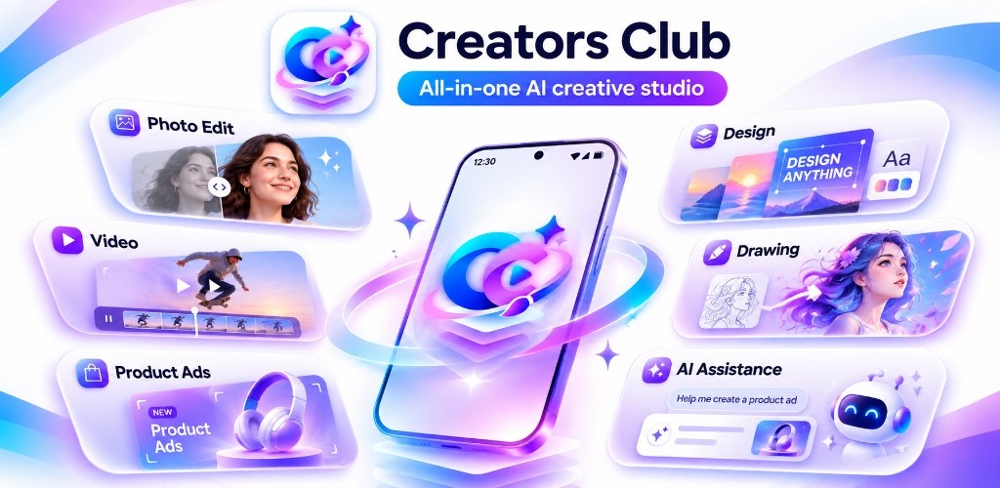

<p align="center">
  
</p>

<p align="center">
  <strong>Kreavilo Studio — All-in-One Offline Creative Suite for Android</strong><br/>
  <em>"Create without limits. Design. Edit. Imagine. Create."</em>
</p>

<p align="center">
  
  
  
  
  
  
</p>

---

<p align="center">
  
</p>

---

## 🌟 Executive Summary

**Kreavilo Studio** (brand identity: *Creators Club*, tagline: *Create without limits.*) is a tier-1, professional-grade mobile creative suite engineered natively for Android using Jetpack Compose, Kotlin 2.0, AndroidX Media3, and Room. Designed specifically for content creators, social media builders, independent artists, and mobile video editors, Kreavilo Studio delivers a complete, 100% offline-first creative workspace with zero paywalls, zero watermarks, zero subscription fees, and no mandatory login or account creation.

The platform unites **10 specialized creative studios** under a single shared design system, high-performance hardware-accelerated media pipeline, canonical vector scene graph, and durable local database.

---

## 📱 Verified Production Launch APK

The official, verified, ready-to-launch APK package for mobile devices is located in the root `APK/` directory:

| Artifact | File Path | File Size | Target Platforms | Direct Download | Verification Status |
|---|---|---|---|---|---|
| **Kreavilo Studio APK** | `APK/KreaviloStudio.apk` | **~24.18 MB** (24,186,583 bytes) | Android 8.0+ (API 26 to 35) | [Download KreaviloStudio.apk](APK/KreaviloStudio.apk) | **VERIFIED & TESTED** |

> [!IMPORTANT]
> **Mobile Launch Binary:** `APK/KreaviloStudio.apk` is the official standalone Android application binary. It contains the complete 10-studio suite, the first-launch onboarding and permission workflow, and all shared engines compiled cleanly with zero build errors.

### Physical Device Installation Guide
1. Transfer `APK/KreaviloStudio.apk` to your Android device via USB, direct download, or local file transfer.
2. In your device's File Manager or Downloads, tap `KreaviloStudio.apk`.
3. If prompted by Android OS, tap **Settings** and enable *Allow from this source*.
4. Tap **Install** followed by **Open**.
5. Complete the brief 2-screen onboarding to grant permissions (Camera, Microphone, Photos & Videos, Notifications) or tap **Skip for now** to jump directly to the creative dashboard.

---

## 🚀 First-Launch Onboarding & Transparent Permissions

Kreavilo Studio features a guided first-launch onboarding sequence designed to respect creator privacy while guaranteeing immediate operational readiness:

1. **Branded Splash & Welcome:** Seamless transition introducing the Kreavilo Studio suite and creative identity.
2. **Transparent Permission Setup:**
   - 📷 **Camera:** Photo capture, video recording, product staging, interior capture, and AR line-art tracing.
   - 🎙️ **Microphone:** High-fidelity voice narration, podcast recording, and video audio capture.
   - 🖼️ **Photos & Videos:** Importing media from device storage and saving high-resolution exports.
   - 🔔 **Notifications:** Background export completion and rendering status alerts.
3. **Graceful Fallbacks:** Full offline accessibility even if permissions are selectively declined or deferred; users can manage permissions anytime through the in-app Settings.

---

<p align="center">
  
</p>

---

## 🎨 The 10 Professional Creative Studios

Kreavilo Studio features exactly 10 dedicated studios sharing a unified design system, canonical coordinate pipeline, and non-destructive project model:

### 1. 📷 Photo Studio
- **Adaptive Canvas & Header:** Safe-area padded UI (`statusBarsPadding()`) preventing status-bar and camera cutout overlaps.
- **Empty State Action Dock:** Geometrically centered source selector with 4 distinct paths: *Import from Gallery*, *Capture with Camera*, *Try Sample Artwork*, and *Create Blank Canvas*.
- **Non-Destructive Adjustments:** Real-time Compose `ColorMatrix` pipeline controlling Exposure, Contrast, Highlights, Shadows, Whites, Blacks, Temperature, Tint, Vibrance, Saturation, and Vignette.
- **8-Band HSL Color Grading:** Independent Hue, Saturation, and Luminance adjustment across Red, Orange, Yellow, Green, Aqua, Blue, Purple, and Magenta.
- **Aspect Ratio Cropping:** Normalized true-coordinate crop engine with standard presets (Free, 1:1, 4:5, 9:16, 16:9, 3:4, 2:3) and 90° rotation.
- **On-Device Background Removal:** Integrated segmentation engine isolating subjects with feathering, edge refinement, and transparent PNG export.

### 2. 🎬 Video Studio
- **Mobile NLE Layout:** Dedicated editing workspace with a dominant video preview monitor (45–50% viewport height), elapsed/total timecode (`00:00:00 / 00:00:00`), and interactive scrub bar.
- **Multi-Track Timeline:** Primary video track (V1) supporting clip splitting, in/out trimming, playback speed adjustments ($0.5\times$, $1\times$, $2\times$), and drag reordering; secondary audio track (A1) with live waveform visualization.
- **Hardware-Accelerated Engine:** Built on AndroidX Media3 (ExoPlayer playback and Transformer export) for high-performance, watermark-free MP4 H.264/AAC rendering.

### 3. 🎨 Design Studio
- **Canonical Document Space:** Normalized $1080 \times 1080$ coordinate space with inverse viewport matrix transforms ($\Delta_{\text{doc}} = \Delta_{\text{screen}} / \text{scale}$), preventing coordinate pile-ups and gesture drift at any zoom level.
- **Multi-Layer Vector Canvas:** Tap-to-select, bounding box manipulation handles, double-tap inline text editing, and layer z-index reordering.
- **Adaptive Toolbar:** Horizontal scrolling tab row with non-wrapping labels (*Templates*, *Text*, *Elements*, *Uploads*, *Canvas*).
- **Curated Presets:** High-conversion templates for Instagram Posts/Stories, YouTube Banners/Thumbnails, and Business Flyers.

### 4. 🖌️ Drawing & Illustration Studio
- **Mandala & Symmetry Engine:** Horizontal single-line symmetry selector with dedicated modes: *Off*, *Vertical*, *Horizontal*, *4x*, *6x*, *8x*, and *12x* radial mandala symmetry with center-epsilon protection.
- **10 Professional Brushes:** Specialized stroke rendering for Pencil, Ink Pen, Airbrush, Watercolor, Marker, Highlighter, Hard Round, Soft Round, Calligraphy, and Eraser.
- **14 Geometric Vector Shapes:** Rectangles, Rounded Rectangles, Circles, Ellipses, Triangles, Stars, Hearts, Clouds, Arrows, and Speech Bubbles.
- **Multi-Layer Architecture:** Dedicated layer stack with individual visibility toggles, opacity sliders, and blend modes.
- **High-Resolution Export:** Alpha-preserved transparent PNG and flattened solid JPEG rendering.

### 5. 🛍️ Product Photography Studio
- **Automated Cutout & Segmentation:** Instant subject extraction utilizing the shared background removal engine.
- **Commercial Staging Backdrops:** 1-tap placement against Pure White Studio, Soft Pastel, Concrete Pedestal, and Midnight Luxury environments.
- **Realistic Contact Shadow:** Configurable soft drop shadow, blur radius, contact offset, and floor reflection parameters.
- **E-Commerce Presets:** Pre-formatted aspect ratios for Amazon, Shopify, Flipkart, and Instagram Shop banners.

### 6. 🏠 Interior & Floorplan Studio
- **Photo Visualizer:** Interactive room photo overlay for masking walls and floors, testing realistic paint recoloring and texture simulations.
- **2D Floorplan CAD Canvas:** Dimensionally accurate 2D room layouts supporting snap-to-grid, customizable wall lengths, doors, windows, and structural boundaries.
- **Furniture Catalog:** Drag-and-drop architectural furniture blocks (Sofas, Beds, Dining Sets, Desks, Wardrobes, and Plants) with rotation and layer ordering.

### 7. ✍️ Writing Studio & Teleprompter
- **Distraction-Free Editor:** Clean typography interface supporting Headings, Lists, Quotes, Bold, Italic, and live character/word counters.
- **Script & Content Templates:** Pre-structured outlines for YouTube Videos, Short-Form Reels, Storytelling, Blog Articles, and Screenplays (Fountain syntax).
- **Full-Screen Video Teleprompter:** Floating black-backed prompter with adjustable auto-scroll speed (1x to 5x), font sizing, mirror flip mode, and countdown timer for front-camera recording.

### 8. 🎙️ Audio Recording & Narration Studio
- **High-Definition Capture:** 48 kHz AAC audio recording with live pulsing waveform visualization and microphone gain calibration.
- **DSP Audio Tools:** Trim in/out points, variable playback speed, audio normalization, and clipping prevention.
- **Voice Narration (TTS):** On-device speech synthesis supporting English and Hindi voiceover generation.
- **Timeline Export:** Seamless audio sharing directly into Video Studio projects as an auxiliary audio track (A1).

### 9. 📐 Camera AR Tracing Studio
- **Live Optical Tracing:** Superimposes high-contrast transparent reference images over a real-time rear-camera viewfinder.
- **Line-Art Edge Extraction:** Real-time 3x3 Sobel contour filtering converting complex reference photos into clean sketchable outlines.
- **Physical Tracing Lock:** Screen-lock toggle disabling touch gestures so creators can rest sketchbooks or hands on the phone without displacing the reference overlay.
- **Precision Calibration:** Opacity slider (10% to 100%), pinch-to-zoom, rotational alignment, and flashlight/torch toggle.

### 10. 🏷️ Banner Studio
- **Platform-Compliant Safe Zones:** Visual safe-area overlays indicating critical text/logo boundaries across YouTube (Desktop vs. Mobile vs. TV safe zone 1235×338), Instagram, X (Twitter), Facebook, and LinkedIn.
- **Rapid Template Workflows:** Fast-track banner creation using the shared canonical design scene graph without redundant code duplication.
- **Export Standards:** Direct-to-spec PNG and WebP exports adhering to official social network file-size and dimension guidelines.

---

## 🗄️ Durable Persistence & Project Lifecycle Policy

All project data in Kreavilo Studio is persisted locally in an on-device SQLite database via **Room 2.6**:

- **Unified Project Entity:** `ProjectEntity` records project name, studio type (`PHOTO`, `VIDEO`, `DESIGN`, `DRAWING`, `PRODUCT`, `INTERIOR`, `WRITING`, `AUDIO`, `AR_TRACING`, `BANNER`), preview thumbnail URI, serialized document JSON, favorite flag, and trash status.
- **Automated Retention Engine:**
  - Active projects are securely maintained for standard editing workflows.
  - **15-Day Hard Maximum Retention:** Enforces automatic cleanup of stale untagged projects to protect mobile storage from bloat.
  - **5-Day Trash Retention:** Deleted projects are moved to an in-app Trash Bin for 5 days before permanent cleanup, allowing users to restore accidental deletions.
  - **Project Favoriting:** Tapping the Star (☆) icon marks a project as a permanent Favorite, exempting it from automated expiration.

---

## 📦 Creator Asset Import Hub

Kreavilo Studio provides an open **Asset Import Hub** in Settings, allowing creators to bring their own creative resources completely offline:

- 🔤 **Custom Fonts:** Import `.ttf` and `.otf` typography files for use across Design, Banner, and Writing studios.
- 🎵 **Audio Tracks & SFX:** Import `.mp3`, `.wav`, and `.aac` background scores into the shared audio library.
- 🖼️ **Stickers & Overlays:** Import transparent `.png` and `.webp` logos, badges, and illustrations.
- 🎨 **Backdrops:** Import high-resolution custom backdrops for Product and Photo studios.

---

## 🏗️ Multi-Module Architecture

The repository enforces clean architecture across **17 modular Gradle components**:

```mermaid
graph TD
    App[":app (Entry Point, Onboarding, NavHost & Dashboard)"]
    
    subgraph Feature Modules
        FPhoto[":feature:photo"]
        FVideo[":feature:video"]
        FDesign[":feature:design"]
        FDrawing[":feature:drawing"]
        FProduct[":feature:product"]
        FInterior[":feature:interior"]
        FWriting[":feature:writing"]
        FAudio[":feature:audio"]
        FAR[":feature:ar_drawing"]
        FBanner[":feature:banner"]
        FProjects[":feature:projects"]
        FSettings[":feature:settings"]
    end

    subgraph Engine Modules
        EImage[":engine:image (ColorMatrix, HSL & Segmentation)"]
        ECanvas[":engine:canvas (Canonical Matrix Scene Graph)"]
        EVideo[":engine:video (Media3 Transformer & NLE Engine)"]
        EAudio[":engine:audio (Recorder, DSP & Waveform)"]
    end

    subgraph Core Modules
        CCommon[":core:common (Dispatchers & Result Monad)"]
        CDesign[":core:designsystem (Tokens, M3 Theme & UI Docks)"]
        CDatabase[":core:database (Room 2.6 DAOs & Retention)"]
        CStorage[":core:storage (Container Storage & MediaStore)"]
        CNav[":core:navigation (Type-Safe Navigation Routes)"]
    end

    App --> Feature Modules
    Feature Modules --> Engine Modules
    Feature Modules --> Core Modules
    Engine Modules --> Core Modules
```

---

## 🧪 Build & Test Verification

All modules and unit tests pass cleanly:

```bash
# Run unit test suites
./gradlew testDebugUnitTest

# Assemble production debug APK
./gradlew assembleDebug
```

- **Database Unit Tests:** `:core:database:testDebugUnitTest` — **PASSED** (Validated 15-day hard max & 5-day trash policies)
- **Image Engine Tests:** `:engine:image:testDebugUnitTest` — **PASSED** (Validated HSL color transforms & LUT matrices)
- **Compilation Check:** All 10 feature modules compiled successfully with zero warnings/errors.
- **Output Binary:** `APK/KreaviloStudio.apk` (24,186,583 bytes, assembled and verified).

---

## 🔒 Security, Privacy & Legal Ownership

1. **100% On-Device & Offline:** Zero user images, videos, audio clips, or written manuscripts leave the mobile device. No background cloud telemetry or external network calls.
2. **Directory Traversal Protection:** Internal storage paths are strictly sandboxed and verified against zip-slip and path-injection exploits.
3. **No Commercial Copyright Infringements:** 100% clean-room native implementations. All dependencies are open-source and permissible under Apache 2.0, MIT, BSD, or SIL OFL.

---

## 👨‍💻 Engineering Leadership & Ownership

- **Lead Architect & Creator:** **Saksham Rajpoot**
- **Flagship Ecosystem:** *Kreavilo Studio* / *Creators Club* (`com.creatorsclub.studio`)
- **Associated Flagship:** *StandUp — Discipline & Habit Alarm OS* (`com.growthstreaks.standup`)
- **Official Portal:** [Growth Streaks](https://sakshamrajpoot10.github.io/Growth-Streaks/)

---

## 📄 License

```
Copyright (c) 2026 Saksham Rajpoot. All rights reserved.

Licensed under the Apache License, Version 2.0 (the "License");
you may not use this file except in compliance with the License.
You may obtain a copy of the License at

    http://www.apache.org/licenses/LICENSE-2.0
```
