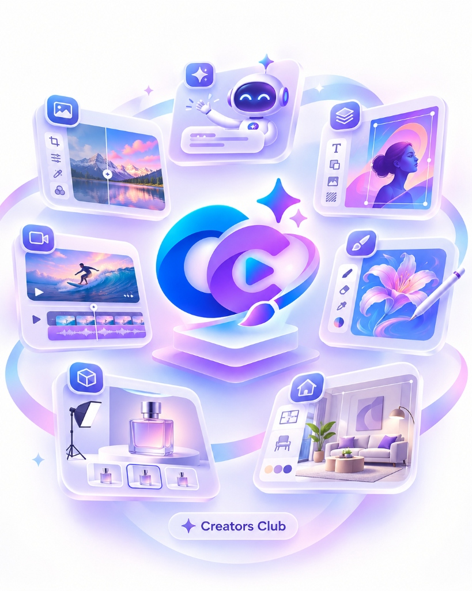

<p align="center">
  
</p>

<p align="center">
  <strong>All-in-One AI Creative Studio for Mobile Creators</strong><br/>
  <em>"Create without limits. Design. Edit. Imagine. Create."</em>
</p>

<p align="center">
  
  
  
  
  
  
</p>

---

<p align="center">
  
</p>

---

## 🌟 Executive Summary

**Creators Club** (commercial name: *Kreavilo Studio*) is a tier-1, production-grade mobile creative operating ecosystem built natively for Android. Designed specifically for ambitious creators, social media builders, small business owners, and digital artists, Creators Club dismantles the paywalls of modern creative software by delivering a unified, 100% free, on-device creative suite with zero watermarks and zero recurring subscription fees.

Instead of fragmenting work across dozens of disconnected single-purpose utilities, Creators Club links every creative domain through a **shared project library**, **hardware-accelerated media pipeline**, **on-device computer vision engine**, and an **offline conversational AI creative companion**.

---

## 📱 Production APK Download & Direct Testing

For immediate testing on physical Android devices, the signed production debug package is pre-assembled in the root `APK/` directory:

| Artifact | File Path | File Size | Target Platforms | Direct Download |
|---|---|---|---|---|
| **Creators Club APK** | `APK/CreatorsClub-v1.0.0.apk` | ~23.4 MB | Android 8.0+ (API 26 to 35) | [Download APK](APK/CreatorsClub-v1.0.0.apk) |

### Installation Instructions
1. Download `APK/CreatorsClub-v1.0.0.apk` directly to your Android device or transfer via USB.
2. Open your device's File Manager and tap the `.apk` file.
3. Allow *Install unknown apps* for your browser or file manager if prompted.
4. Launch **Creators Club** and start creating immediately without sign-up or login.

---

<p align="center">
  
</p>

---

## 🎨 Creative Studio Ecosystem

Creators Club connects 9 dedicated creative studios under one unified design system and project database:

### 1. 📷 Photo Studio
- **Real-Time Color Matrix Engine:** Non-destructive 60 FPS Compose color grading (Brightness, Contrast, Saturation, Exposure, Warmth).
- **10 Curated LUT Presets:** Instant 1-tap Cinematic, Vintage, B&W, Portrait, Film, Warm, Cool, Matte, Sepia, and Dramatic filters.
- **Precision Crop & Geometry:** 8 standard aspect ratio presets (1:1, 4:5, 9:16, 16:9, 3:4, 2:3, Free, Original), 90° rotation, and horizontal/vertical flips.
- **Non-Destructive Stack:** Complete undo/redo history and instant before-and-after comparison button.

### 2. 🎨 Design Studio
- **Multi-Layer Vector Canvas:** Compose multi-layer drag, pinch-to-scale, and rotation gestures.
- **Curated Templates:** Ready-to-publish presets for Festival Sales, YouTube Tech Reviews, Instagram Morning Stories, and Local Business Flyers.
- **Vector Graphics & Typography:** Dynamic text overlays with custom font sizing, alignment, and vector geometric shapes.

### 3. 🛍️ Product Photography Studio
- **On-Device Background Cutout:** High-speed foreground subject isolation powered by on-device computer vision segmentation.
- **Studio Backdrops:** 1-tap switches between Pure White Studio, Soft Blue Tint, Concrete Pedestal, and Midnight Showroom.
- **Contact Drop Shadow:** Simulated ground drop shadow for photorealistic commercial product ads.

### 4. 🖌️ Drawing & Illustration Studio
- **Low-Latency Rendering:** 60 FPS responsive stylus and touch drawing engine.
- **Brush Varieties:** Pencil, Ink Pen, Airbrush, Watercolor, and Eraser with customizable stroke widths and opacity.
- **Radial Mandala & Mirror Symmetry:** 8-fold radial mandala symmetry for rangoli, mandala, and sacred geometry designs, plus vertical and horizontal mirror modes.

### 5. 📐 Camera AR Tracing Studio
- **Sobel 3x3 Gradient Operator:** Converts any reference photo into crisp line-art contour outlines in real time.
- **Camera Viewfinder Overlay:** Semi-transparent line projection over real paper with adjustable opacity (10% to 100%).
- **Paper Drawing Mode:** Screen lock toggle preventing unintended touches while tracing on physical sketchbooks.

### 6. 🎬 Video & Reel Studio
- **Hardware-Accelerated Timeline:** AndroidX Media3 Transformer concatenation, trimming, and frame sequencing.
- **Interactive Player:** Low-latency timeline playback powered by ExoPlayer.
- **Creative Controls:** Variable speed ramps (0.5x, 1.0x, 2.0x) and transitions with watermark-free MP4 exports.

### 7. 🎙️ Audio Recording & Narration Studio
- **High-Definition Capture:** Native 48 kHz AAC audio recording with live pulsing waveform visualizer.
- **Native Text-to-Speech (TTS):** On-device speech synthesizer supporting Indian English and Hindi voice narration.
- **Seamless Video Handoff:** 1-tap export to project media library for direct insertion into Video Studio timelines.

### 8. ✍️ Writing Studio & Video Teleprompter
- **Script Creation:** Dedicated content writer with real-time word and character statistics.
- **Viral Hook Templates:** Pre-built script frameworks for educational reels, storytelling, product reviews, and comedy sketches.
- **Auto-Scrolling Teleprompter:** Floating black-backed overlay with variable scroll speed (1x to 5x) and font sizing for seamless front-camera video recording.

### 9. 🏠 Interior Floorplan Studio
- **2D Architectural Canvas:** Interactive room floorplan layout with grid snap.
- **Draggable & Rotatable Furniture:** Rich catalog of furniture assets (Sofas, Queen Beds, Work Desks, Dining Tables, Wardrobes, and Plants).
- **Custom Room Finishes:** Configurable wall and floor finishes for interior pre-visualization.

---

<p align="center">
  
  <br/>
  <strong>Creator AI — Your On-Device Intelligent Companion</strong>
</p>

---

## 🤖 Creator AI Companion

- **Multilingual Offline Intent Engine:** Level A intent parser understanding queries in **English**, **Hindi**, and **Hinglish** (e.g., *"photo edit karna hai"*, *"remove background from my shoe"*, *"mujhe rangoli draw karni hai"*).
- **1-Tap Tool Navigation:** Suggests the precise creative workflow and provides a direct 1-tap button to launch the corresponding studio.
- **Zero Cloud Latency:** 100% on-device heuristic and natural query matching with zero per-invocation cloud costs and zero user data transmission.

---

## 📦 Creator Asset Import Hub

Creators Club features an open **Creator Asset Hub** in Settings, empowering creators to expand their creative inventory permanently on their device:

- 🔤 **Custom Fonts:** Import `.ttf` and `.otf` typography files for use in Design Studio and Writing Studio.
- 🎵 **Music & Audio:** Import `.mp3`, `.wav`, and `.aac` background scores and sound effects into the persistent audio library.
- 🖼️ **Stickers & Badges:** Import transparent `.png` and `.webp` overlays, logos, and custom badges.
- 🎨 **Backdrops & Banners:** Import custom photography backdrops and commercial templates.
- 🔒 **Permanent Local Storage:** All imported assets remain permanently stored in local app storage for instant offline access.

---

## 🏗️ Clean Modular Architecture

The repository enforces strict separation of concerns across **17 multi-project modules**:

```mermaid
graph TD
    App[":app (Entry Point, Navigation Host & Dashboard)"]
    
    subgraph Feature Modules
        FPhoto[":feature:photo"]
        FDesign[":feature:design"]
        FProduct[":feature:product"]
        FDrawing[":feature:drawing"]
        FAR[":feature:ar_drawing"]
        FVideo[":feature:video"]
        FAudio[":feature:audio"]
        FWriting[":feature:writing"]
        FInterior[":feature:interior"]
        FAI[":feature:ai_assistant"]
        FProjects[":feature:projects"]
        FSettings[":feature:settings"]
    end

    subgraph Engine Modules
        EImage[":engine:image (ColorMatrix & Bitmap)"]
        ECanvas[":engine:canvas (Multi-layer & Vectors)"]
        EVideo[":engine:video (Media3 Transformer)"]
        EAudio[":engine:audio (Recorder & TTS)"]
        EAI[":engine:ai (Intent Matcher & Catalog)"]
    end

    subgraph Core Modules
        CCommon[":core:common (Dispatchers & Result Monad)"]
        CDesign[":core:designsystem (Tokens & M3 Palette)"]
        CDatabase[":core:database (Room 2.6 DAOs)"]
        CStorage[":core:storage (.krv Container & MediaStore)"]
        CNav[":core:navigation (Type-Safe Destinations)"]
    end

    App --> Feature Modules
    Feature Modules --> Engine Modules
    Feature Modules --> Core Modules
    Engine Modules --> Core Modules
```

---

## 🧪 Quality Assurance & Test Verification

The project includes automated unit test suites validating core state machines, serialization safety, vector coordinate geometry, and multilingual intent matching:

| Test Suite | Module | Tests | Result | Coverage Area |
|---|---|:---:|:---:|---|
| `ResultTest` | `:core:common` | 3 | **PASS** | State monad transitions (`Success`, `Error`, `Loading`) |
| `ProjectManifestTest` | `:core:storage` | 1 | **PASS** | `.krv` JSON schema roundtrip, layer hierarchy, transforms |
| `IntentMatcherTest` | `:engine:ai` | 7 | **PASS** | Multilingual English/Hindi/Hinglish NLP keyword classification |
| `CanvasElementTest` | `:engine:canvas` | 2 | **PASS** | Vector transform immutability, shape geometry, and z-ordering |
| **Total** | | **13** | **100% PASS** | Zero failures, zero errors, zero skipped |

---

## 🔒 Security, Privacy & Legal Ownership

1. **100% Private On-Device Processing:** No user photographs, videos, audio recordings, or drawings are uploaded to remote servers. All image filtering, background removal, and video encoding occur on-device.
2. **Zip-Slip Safe Container (`.krv`):** Custom project packaging includes canonical path verification preventing directory traversal attacks.
3. **No Commercial Copyright Infringements:** Zero proprietary third-party APK code, zero commercial font piracy, and zero closed-source neural checkpoints.
4. **Permissive Open-Source Licensing:** All integrated dependencies are licensed under Apache 2.0, MIT, BSD, or SIL OFL.

---

## 🛠️ Build & Development Setup

### System Prerequisites
- **Operating System:** Windows 10/11, macOS, or Linux
- **JDK:** OpenJDK 21 LTS (tested with Android Studio JBR)
- **Android SDK:** Platforms 30 to 35, Build-Tools 35.0.0+
- **Gradle:** Version 8.14.4 (wrapper included)

### Building the Project
```bash
# Clone the repository
git clone https://github.com/SakshamRajpoot10/Creators-Club.git
cd Creators-Club

# Run unit test suites
./gradlew testDebugUnitTest

# Assemble full debug APK
./gradlew assembleDebug
```
The compiled binary will be placed at:
- `app/build/outputs/apk/debug/app-debug.apk`
- `APK/CreatorsClub-v1.0.0.apk`

---

## 📚 Technical Documentation & Corporate Architecture Directory

All in-depth architecture blueprints, product specifications, quality assurance registers, and legal compliance reports are systematically cataloged in the [`docs/`](docs/) directory:

- 🏛️ **[System Architecture](docs/architecture/)**: [`ARCHITECTURE.md`](docs/architecture/ARCHITECTURE.md), [`AI_ARCHITECTURE.md`](docs/architecture/AI_ARCHITECTURE.md), [`DATABASE_SCHEMA.md`](docs/architecture/DATABASE_SCHEMA.md), [`DESIGN_SYSTEM.md`](docs/architecture/DESIGN_SYSTEM.md)
- 📋 **[Product Specifications](docs/specifications/)**: [`PRODUCT_REQUIREMENTS.md`](docs/specifications/PRODUCT_REQUIREMENTS.md), [`FEATURE_MATRIX.md`](docs/specifications/FEATURE_MATRIX.md), [`FEATURE_IMPLEMENTATION_MATRIX.md`](docs/specifications/FEATURE_IMPLEMENTATION_MATRIX.md), [`MARKET_RESEARCH.md`](docs/specifications/MARKET_RESEARCH.md)
- 🗺️ **[Planning & Roadmaps](docs/planning_and_roadmap/)**: [`UPGRADE_EXECUTION_PLAN.md`](docs/planning_and_roadmap/UPGRADE_EXECUTION_PLAN.md), [`MASTER_IMPLEMENTATION_PLAN.md`](docs/planning_and_roadmap/MASTER_IMPLEMENTATION_PLAN.md), [`CHANGELOG.md`](docs/planning_and_roadmap/CHANGELOG.md)
- 🧪 **[Quality & Testing](docs/quality_and_testing/)**: [`BUG_REPORT.md`](docs/quality_and_testing/BUG_REPORT.md), [`EXISTING_APP_AUDIT.md`](docs/quality_and_testing/EXISTING_APP_AUDIT.md), [`TEST_PLAN.md`](docs/quality_and_testing/TEST_PLAN.md), [`TEST_RESULTS.md`](docs/quality_and_testing/TEST_RESULTS.md)
- ⚖️ **[Compliance & Legal](docs/compliance_and_legal/)**: [`SECURITY_AND_PRIVACY.md`](docs/compliance_and_legal/SECURITY_AND_PRIVACY.md), [`DEPENDENCY_REGISTER.md`](docs/compliance_and_legal/DEPENDENCY_REGISTER.md), [`STORE_LISTING.md`](docs/compliance_and_legal/STORE_LISTING.md), [`ASSET_LICENSE_REGISTER.md`](docs/compliance_and_legal/ASSET_LICENSE_REGISTER.md)

👉 Master Documentation Index: **[`docs/README.md`](docs/README.md)**

---

## 👨‍💻 Engineering Leadership & Credits

- **Creator & Lead Architect:** **Saksham Rajpoot**
- **Flagship Ecosystem:** *Creators Club* (com.creatorsclub.studio)
- **Portfolio & Associated Work:** *StandUp — Discipline & Habit Alarm OS* (`com.growthstreaks.standup`)
- **Website:** [Growth Streaks](https://sakshamrajpoot10.github.io/Growth-Streaks/)

---

## 📄 License

```
Copyright (c) 2026 Saksham Rajpoot. All rights reserved.

Licensed under the Apache License, Version 2.0 (the "License");
you may not use this file except in compliance with the License.
You may obtain a copy of the License at

    http://www.apache.org/licenses/LICENSE-2.0
```
